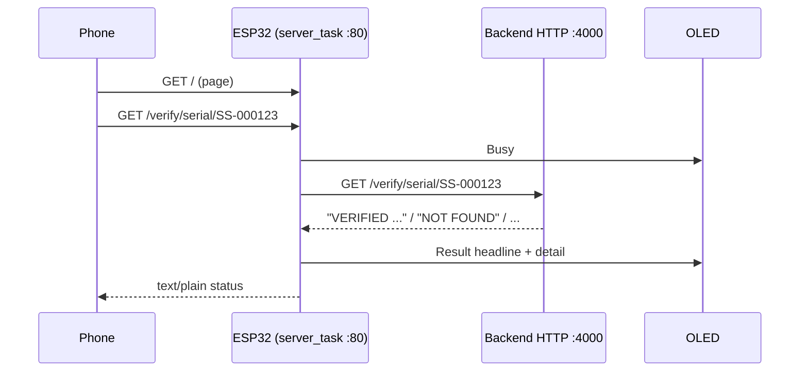
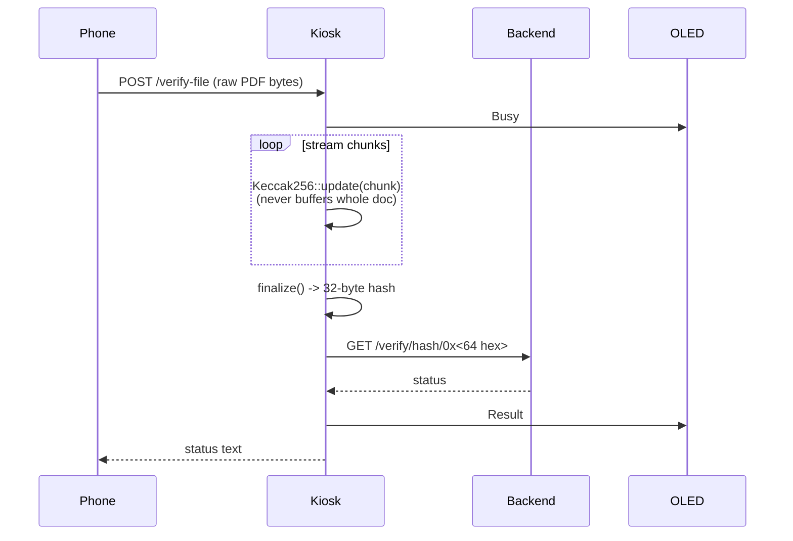
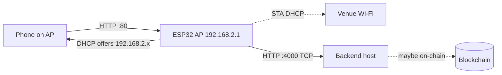

# Suraksha Setu — Firmware: Working & Architecture

Verification kiosk for NOC documents running on an ESP32-S3. This document
explains how the firmware works and answers the question: **is blockchain
implemented in the firmware?**

## Is blockchain implemented in the firmware?

**No.** The firmware contains no blockchain client, wallet, RPC endpoint, or
on-chain logic. Its only cryptographic primitive is **Keccak-256 hashing**
(`tiny-keccak`, the EVM/Solidity variant) used to compute a document
fingerprint. Verification is delegated to the backend over plain HTTP; any
on-chain check happens server-side.

Dependencies confirm this: `esp-hal`, `esp-wifi`, `embassy-net`, `tiny-keccak`,
`ssd1306` — no `alloy`, `ethers`, `web3`, or similar.

Keccak-256 is chosen specifically to match Solidity `keccak256` and the
backend's `@noble/hashes` output, so the backend can compare the device's
fingerprint against on-chain hashes without conversion.

---

## Hardware assumed

- ESP32-S3 dev board
- SSD1306 128x64 OLED on I2C (SDA = GPIO8, SCL = GPIO9)
- No camera — QR decoding is done by the phone

## Build-time configuration (env vars)

| Var | Default | Meaning |
|---|---|---|
| `KIOSK_AP_SSID` | `SurakshaSetu-Kiosk` | Soft-AP SSID |
| `KIOSK_STA_SSID` | (empty = AP only) | Venue Wi-Fi SSID for upstream |
| `KIOSK_STA_PASS` | (empty) | Venue Wi-Fi password |
| `KIOSK_BACKEND_HOST` | `192.168.1.50` | Backend host |
| `KIOSK_BACKEND_PORT` | `4000` | Backend port |

---

## 1. Boot / task topology

```mermaid
flowchart TD
    MAIN[main()] --> INIT[Init peripherals<br/>heap 72KB, timers, RNG]
    INIT --> WIFI[esp_wifi::wifi::new_ap_sta<br/>AP + STA radios]
    WIFI --> STACKS[Two embassy-net stacks<br/>AP: 192.168.2.1/24 static<br/>STA: DHCP]
    STACKS --> SPAWN[Spawn tasks]
    SPAWN --> CT[connection_task<br/>wifi::run]
    SPAWN --> NA[net_task_ap]
    SPAWN --> NS[net_task_sta]
    SPAWN --> DH[dhcp_task]
    SPAWN --> SV[server_task]
    SPAWN --> DS[display_task]
    DS --> OLED[SSD1306 OLED I2C 8/9]
```

`main()` initializes the HAL at max CPU clock, allocates a 72 KB heap, sets up
two timers (one for embassy, one for esp-wifi), generates RNG seeds, creates an
AP+STA Wi-Fi controller, builds two separate `embassy-net` stacks (AP static,
STA DHCP), then spawns six concurrent tasks and signals `Ready` to the display.

## 2. Verification by serial



## 3. Verification by PDF



## 4. Module responsibilities

| Module | Role |
|---|---|
| `main.rs` | Init HAL, Wi-Fi, two net stacks, spawn 6 tasks, OLED ready signal |
| `wifi.rs` | Configure AP (`SurakshaSetu-Kiosk`, open) + optional STA; reconnect loop |
| `dhcp.rs` | Minimal DHCPv4 server for AP clients (pool 192.168.2.100–119) |
| `server.rs` | HTTP/1.1 server on :80 — serves page, `/verify/serial/`, `/verify-file` |
| `hash.rs` | Streaming Keccak-256 wrapper over `tiny-keccak` |
| `backend.rs` | HTTP client to backend `/verify/serial/` and `/verify/hash/` |
| `display.rs` | SSD1306 OLED driver via embassy signal channel |

## 5. Networking topology



## Key points

- **No on-device blockchain**: the device only hashes and queries the backend.
  Any chain interaction is server-side.
- **Streaming hash** avoids buffering large PDFs in the 72 KB heap.
- **Open AP, no TLS/auth** — explicitly a read-only verification kiosk on a
  softAP (noted limit in `README.md`).

## Known limits

- DHCP server is minimal (single pool, no NAK handling beyond reallocation).
- Open AP only (secured soft-AP not supported by esp-wifi 0.12).
- No TLS/auth on the kiosk page.
- `StackResources<4, 1>` arity assumes embassy-net 0.6.

## What was not verified

Whether the backend actually performs an on-chain lookup — that is outside the
firmware scope and would require inspecting `backend/` and `contracts/`.
